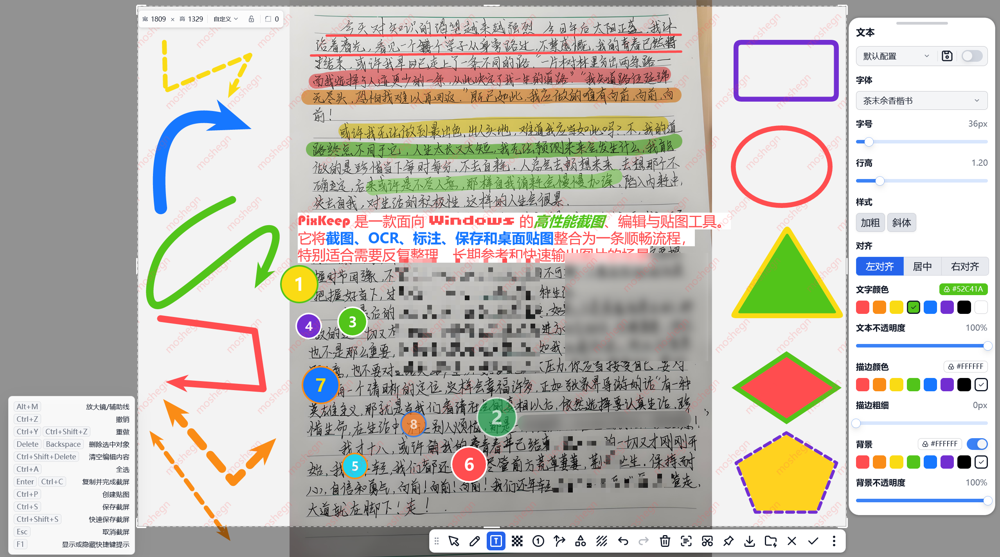
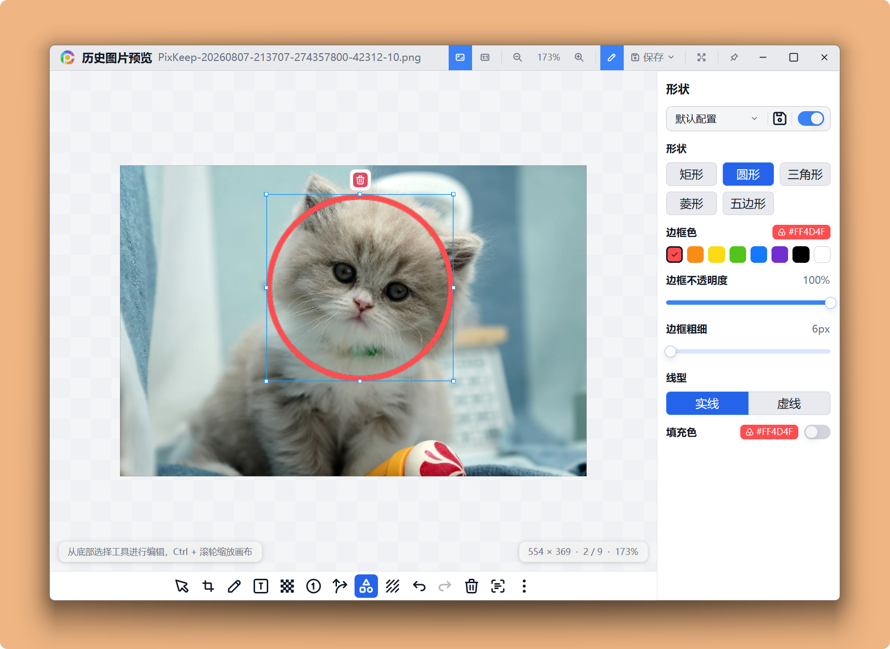
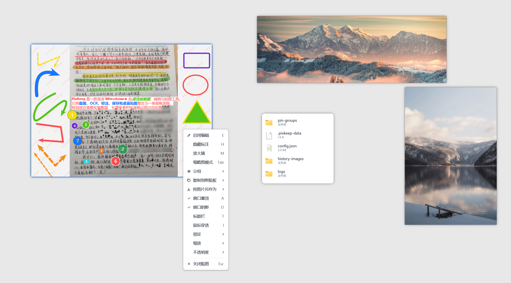
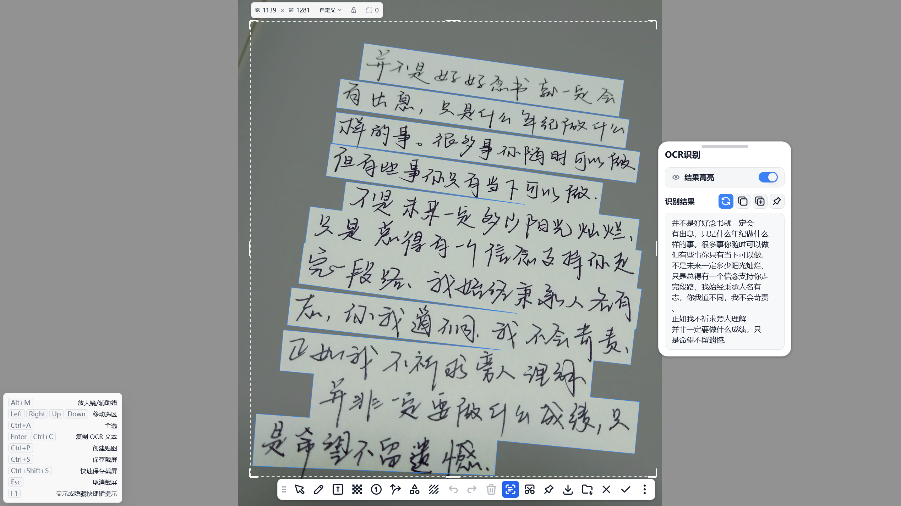
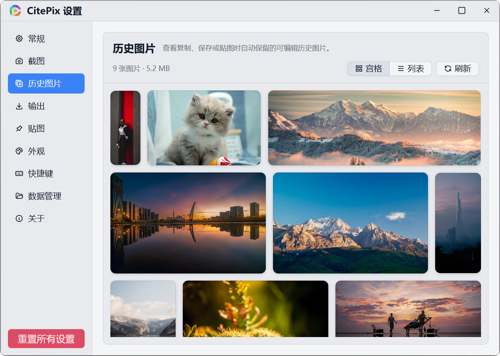
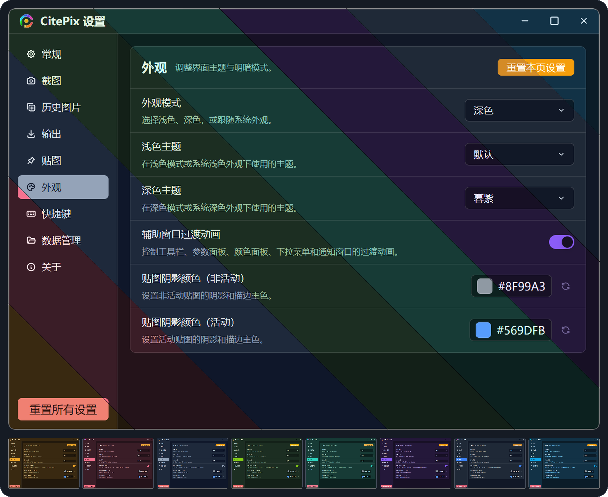
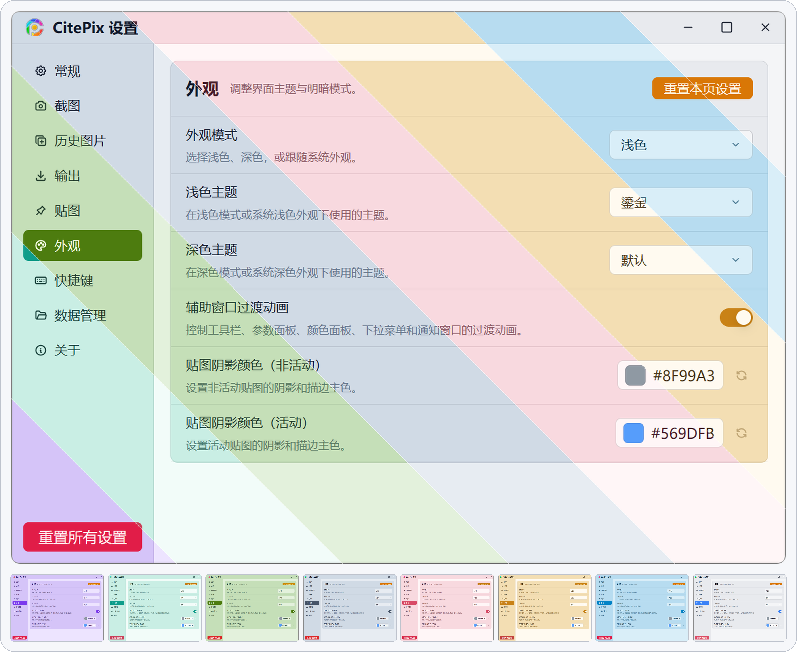
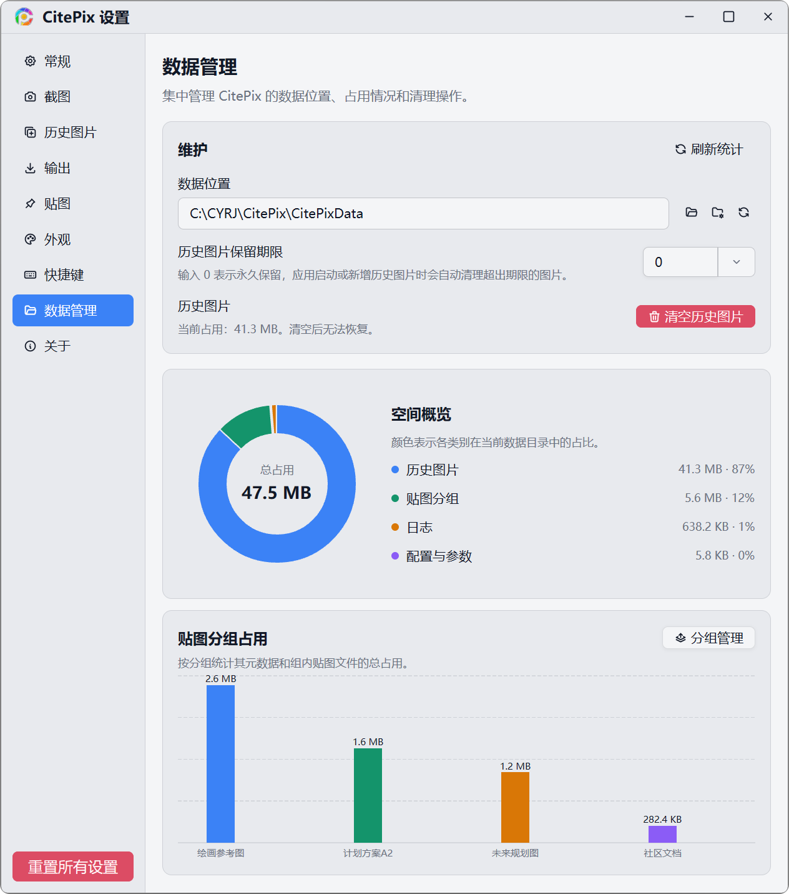

# CitePix

> 不只截一张图，更把重要内容留在手边、随时继续处理。

CitePix 是一款面向 Windows 的高性能截图、编辑与贴图工具。它将截图、OCR、标注、保存和桌面贴图整合为一条顺畅流程，特别适合需要反复整理、长期参考和快速输出图片的场景。

## 核心优势

- **截图不是一次性的**：复制、保存、快速保存或创建贴图后，CitePix 会保留可再次编辑的历史图片。以后仍能重新标注、裁剪、调整马赛克或水印，再保存为新版本；重要内容不必因为一次操作失误而从头再来。
- **万能贴图，选中什么就贴什么**：在其他应用中选中文本、富文本、图片、文件或文件夹，通过全局快捷键即可创建对应贴图。文本可读、图片可看、文件会生成信息卡片，让参考资料、待办内容和常用文件始终留在桌面上。
- **为响应速度而生**：以 Rust 构建，结合 GPU 加速渲染、画布缓存与分块处理，大尺寸截图、长图和复杂标注也能保持流畅；空闲时可自动优化内存占用。截图提供自动、高性能、现代和兼容等多种方式，并支持多显示器和高 DPI 场景。
- **截图、贴图使用同一套编辑能力**：画笔、文本、箭头、形状、序号、马赛克/模糊、边框和水印都可用于截图与贴图。贴图还能继续编辑，并分别导出原图或编辑后的图片。
- **本地 OCR，更安心**：图片文字识别在本机完成，可直接高亮选择、复制全部或部分文字，也能将识别结果一键创建为文本贴图。

## 界面预览

  

截图、标注、参数调整和导出操作集中在同一个编辑界面。

<table>
  <tr>
    <td width="50%" valign="top">
      
      
<strong>历史图片可反复编辑</strong>

    </td>
    <td width="50%" valign="top">
      
      
<strong>图片、文字和文件都能贴到桌面</strong>

    </td>
  </tr>
  <tr>
    <td width="50%" valign="top">
      
      
<strong>识别、选择并复制图片文字</strong>

    </td>
    <td width="50%" valign="top">
      
      
<strong>历史图片集中保留和浏览</strong>

    </td>
  </tr>
  <tr>
    <td width="50%" valign="top">
      
      
<strong>暗色主题</strong>

    </td>
    <td width="50%" valign="top">
      
      
<strong>亮色主题</strong>

    </td>
  </tr>
</table>

  

数据目录、历史图片和贴图分组的占用情况一目了然。

## 一次截图，后续都能处理

CitePix 支持自动窗口/元素选区、像素放大镜、颜色采样和精确选区调整。完成截图后，可立即复制到剪贴板、另存为、快速保存至指定目录、创建置顶贴图，或保留到历史图片中继续处理。

需要长图时，长截屏支持自动滚动、预览和裁剪，并可直接复制、保存或贴到屏幕。输出支持 PNG、JPG、JPEG、WebP、BMP，以及按时间、窗口标题、图片尺寸等信息自动命名。

贴图支持置顶、缩放、透明度、鼠标穿透、缩略图、位置/缩放锁定和分组保存。配合可自定义的全局快捷键、托盘菜单、工具栏和参数记忆，可以把最常用的动作压缩到最少步骤。

CitePix 提供简体中文与 English，支持浅色、深色和跟随系统外观。当前主要面向 Windows 桌面环境；长截屏选区需位于同一台显示器内。

## 反馈与发布

CitePix 为私有闭源应用；本仓库仅用于发布说明、问题反馈和使用交流，不包含主项目源代码。

- [提交问题或建议](https://github.com/mosheng1/CitePix-feedback/issues)
- [查看发布说明](https://github.com/mosheng1/CitePix-feedback/releases)

反馈问题时，请附上 CitePix 版本、Windows 版本、复现步骤、预期结果与实际结果。涉及截图问题时，可补充显示器数量、缩放比例和相关设置；请勿上传包含敏感信息的原图。
