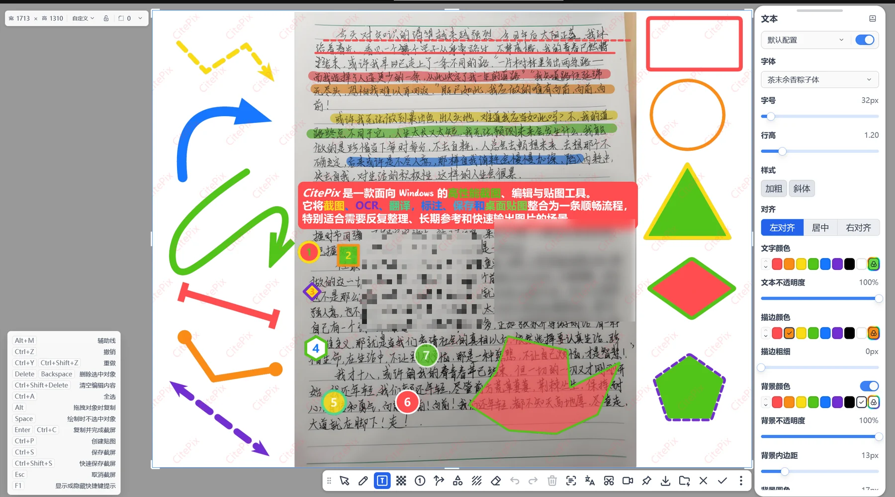
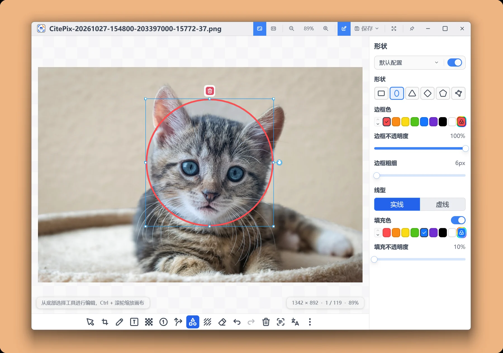
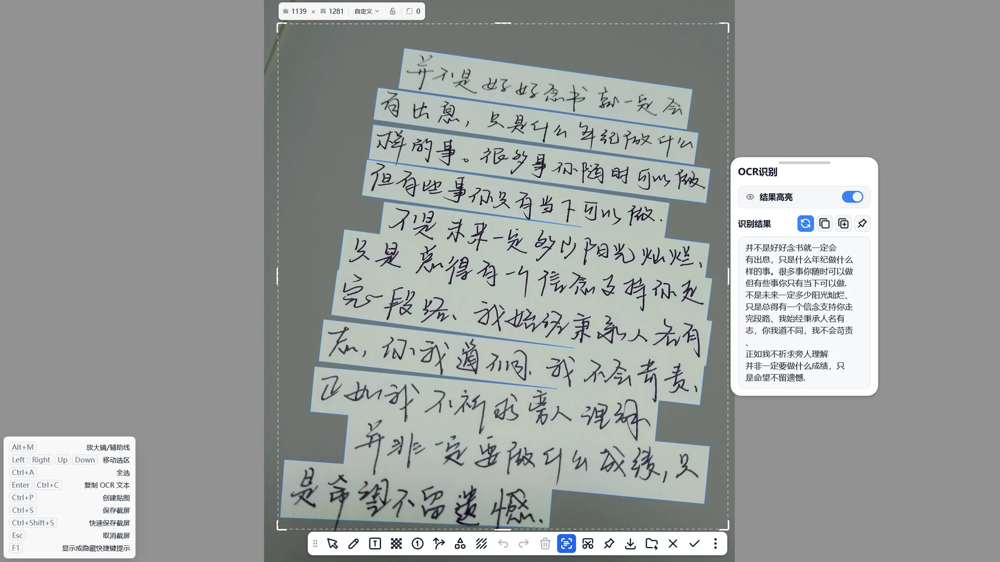
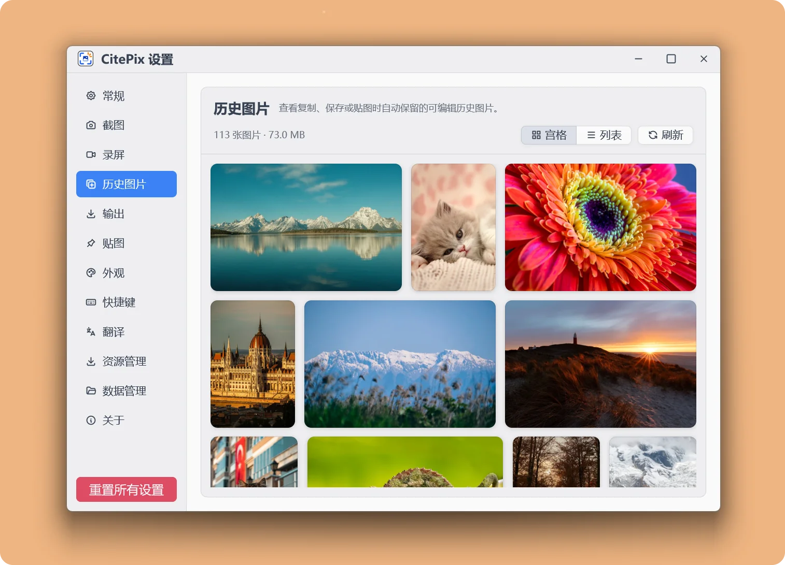
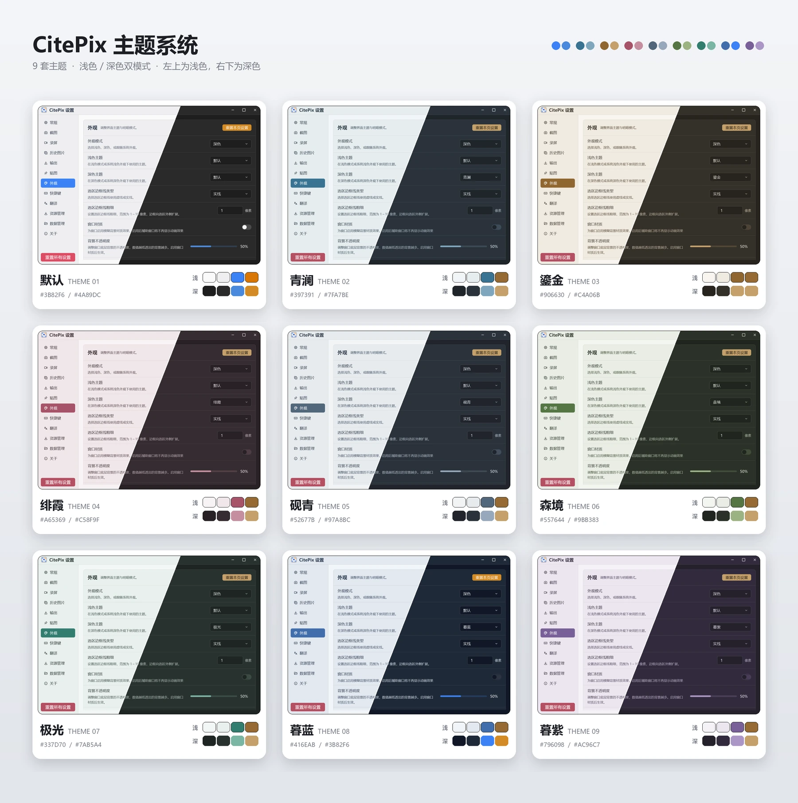

# CitePix

  
  <h1>CitePix</h1>
  
<strong>截图、标注，让重点留在眼前。</strong>

> 不只截一张图,更把重要内容留在手边、随时继续处理。

CitePix 是一款 Windows 原生截图、标注与贴图工具,集成长截屏、屏幕录制、离线 OCR、二维码识别与翻译。它使用 Rust 与 GPU 加速的 GPUI 框架构建,不依赖浏览器内核,大尺寸截图、长图和复杂标注也能保持流畅。

## ✨ 核心特性

- **截图之后还能继续处理** — 复制、保存或贴图的结果会进入历史图片,之后仍可重新标注、裁剪或调整马赛克。重要内容不必因为一次操作失误而从头再来。
- **万能贴图** — 在其他应用中选中文本、富文本、图片、文件或文件夹,通过全局快捷键即可创建对应贴图。文本可读、图片可看、文件会生成信息卡片,让参考资料、待办内容和常用文件始终留在桌面上。
- **为响应速度而生** — 以 Rust 构建,结合 GPU 加速渲染、画布缓存与分块处理,大尺寸截图、长图和复杂标注也能保持流畅;空闲时可自动优化内存占用。
- **截图、贴图使用同一套编辑能力** — 画笔、文本、箭头、形状、序号、马赛克/模糊、边框和水印都可用于截图与贴图。贴图还能继续编辑,并分别导出原图或编辑后的图片。
- **本地 OCR,更安心** — 图片文字识别在本机完成,可直接高亮选择、复制全部或部分文字,也能将识别结果一键创建为文本贴图。

## 📸 界面预览

  

截图、标注、参数调整和导出操作集中在同一个编辑界面

<table>
  <tr>
    <td width="50%" valign="top">
      
      
<strong>历史图片可反复编辑</strong>

    </td>
    <td width="50%" valign="top">
      
      
<strong>图片、文字和文件都能贴到桌面</strong>

    </td>
  </tr>
  <tr>
    <td width="50%" valign="top">
      
      
<strong>识别、选择并复制图片文字</strong>

    </td>
    <td width="50%" valign="top">
      
      
<strong>历史图片集中保留和浏览</strong>

    </td>
  </tr>
</table>

  

九套内置主题,每套都有浅色与深色两种模式

## 🎯 主要功能

### 截图

- **窗口与元素识别** — 悬停即高亮窗口或界面元素,单击选中
- **放大镜与取色** — 像素级放大,一键复制 HEX、RGB 等格式颜色
- **精确选区** — 宽高、圆角、比例锁定、方向键微调和选区配置
- **多种截图方式** — 自动、DXGI、WGC、GDI,兼顾多显示器、高 DPI 与 HDR
- **快速截图** — 选区完成后直接复制、贴图、识别文字或二维码
- **长截屏** — 自动滚动、拖动选区、去除悬浮元素,预览中裁剪

### 标注

- **画笔与荧光笔** — 实线、虚线,Shift 吸附 16 个方向
- **文本** — 字体、描边、背景、圆角与对齐,排版细节都可调
- **箭头与形状** — 曲线或折线箭头,六种头部样式;多边形与圆角形状
- **序号** — 多种编号与外形,可联动文本和箭头
- **马赛克与擦除** — 马赛克或模糊,取样擦除与橡皮擦除
- **边框与水印** — 整图边框;文字水印支持时间戳与平铺

### 贴图

- **万能贴图** — 选中文本、富文本、图片、文件或文件夹,一键贴到屏幕
- **灵活显示** — 10%–800% 缩放、透明度、置顶、阴影与缩略图
- **鼠标穿透与锁定** — 贴图不挡操作,位置和缩放可以锁定
- **继续编辑** — 在贴图上标注,分别导出原图或编辑后图片
- **贴图分组** — 按项目保存一组贴图,随时整组打开

### 识别与翻译

- **离线 OCR** — 内置识别模型,支持中、英、日及多种拉丁字母语言
- **选择与复制** — 拖选部分文字或复制全部,也可创建文本贴图
- **二维码** — 识别后复制内容或直接打开链接
- **截图翻译** — 译文覆盖在原位置,本地模型或在线服务任选

### 屏幕录制

- **多种格式** — MP4、GIF、WebP,15 / 30 / 60 fps
- **声音** — 同时录制系统声音与麦克风,可选择设备
- **操作特效** — 鼠标拖尾、点击特效和按键显示
- **硬件编码** — NVENC、AMF、Quick Sync 与软件编码可选
- **预览与裁剪** — 导出前裁剪片段,支持后台导出

### 历史与输出

- **可编辑的历史** — 重新打开历史图片继续标注,另存为新版本
- **多种格式** — PNG、JPG、WebP、BMP,复制与保存分别设置
- **自动命名** — 按时间、窗口标题、尺寸等变量生成文件名
- **自定义快捷键** — 键盘、鼠标与 Win 组合键,可加入托盘菜单
- **主题与外观** — 九套主题,浅色、深色与跟随系统

## 💾 安装与更新

下载页面提供两种发行包,功能完全一致,区别在于安装方式和数据存放位置:

| 发行包 | 说明 | 数据位置 |
|--------|------|----------|
| 安装版 `.exe` | 运行安装向导,需要管理员权限,可选择创建桌面快捷方式 | `%LOCALAPPDATA%\CitePixData` |
| 便携版 `.zip` | 解压到任意目录后运行 `CitePix.exe`,无需安装 | 程序目录下的 `CitePixData` |

CitePix 会自动检查新版本,在后台下载安装包;确认后一键安装,完成后自动重启应用。也可以在托盘菜单中选择「检查更新」,或在 设置 → 关于 中手动检查。

## 🌍 系统要求

- Windows 10 / 11 x64
- 支持多显示器和高 DPI 场景

## 🔒 数据与隐私

- 截图、标注、OCR、二维码识别和本地翻译模型都在本机运行
- CitePix 不包含使用统计或遥测上报
- 只有检查更新、下载模型和使用你配置的在线翻译服务时才会联网
- 数据目录可在 设置 → 数据管理 中查看和迁移

## 💬 反馈与社区

CitePix 为私有闭源应用;本仓库仅用于发布说明、问题反馈和使用交流,不包含主项目源代码。

- [提交问题或建议](https://github.com/mosheng1/CitePix-feedback/issues)
- [查看发布版本](https://github.com/mosheng1/CitePix-feedback/releases)
- [Gitee 镜像](https://gitee.com/mk-mo-sheng/CitePix-feedback)
- [QQ 交流群](https://qm.qq.com/q/EJyA2T7Xqg)

反馈问题时,请附上:
- CitePix 版本
- Windows 版本
- 复现步骤
- 预期结果与实际结果
- 涉及截图问题时,可补充显示器数量、缩放比例和相关设置

⚠️ 请勿上传包含敏感信息的原图。

---

让每一个值得保留的瞬间,留在触手可及之处。

